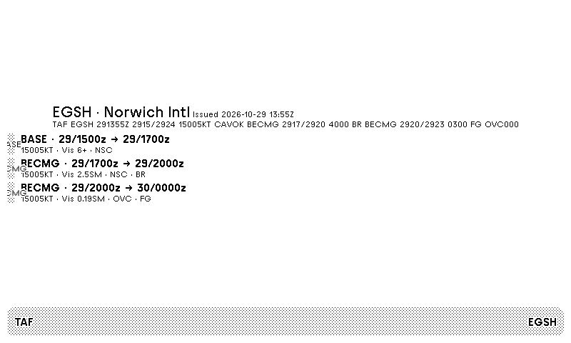

# TAF Forecast

Decoded Terminal Aerodrome Forecast for TRMNL, from aviationweather.gov.



## Data

Forecasts are polled from the NOAA/NWS Aviation Weather Center Data API. No API key.

```
GET https://aviationweather.gov/api/data/taf?ids=EGSH&format=json
```

The response is a JSON array with `rawTAF` and `fcsts[]` (wind, visibility, clouds, weather, and FM/TEMPO/BECMG/PROB groups). Polling sends `User-Agent: trmnl-taf/1.0 (byalex33)`.

Data from [aviationweather.gov](https://aviationweather.gov/) (NOAA/NWS). Built by Alex Baldry.

## Install

### TRMNL import ZIP

The dashboard importer expects a flat ZIP with `settings.yml` at the archive root. Pack the files in `src/` (Liquid layouts, `settings.yml`, and `transform.py`):

```sh
(cd src && zip -r ../taf-forecast.zip .)
```

On the Private Plugin settings page, click **Import new** and select `taf-forecast.zip`. The plugin is created and added to your playlist.

### trmnlp

This repository is a [trmnlp](https://github.com/usetrmnl/trmnlp) project (`.trmnlp.yml` plus `src/`). From the repo root:

```sh
trmnlp serve
```

The preview is at http://localhost:4567. To upload it to your TRMNL account, run `trmnlp login` and then `trmnlp push`.

Install the `trmnlp` command with `gem install trmnl_preview` (Ruby 4 or newer), or use the Docker wrapper in the trmnlp README.

## Custom fields

- `icao` — one ICAO code, or a comma-separated list (for example `EGSH,EGLL`). Default `EGSH` (Norwich).

## Notes

- Times are UTC (`dd/HHmmZ`).
- With more than one airport, compact layouts use the first station. The transform also returns a `stations` array for custom markup.

## License

[MIT](LICENSE) © 2026 Alex Baldry.
